# Design and Implementation of the RCSS Campus Network Using Cisco Packet Tracer

**Project Report — Hardware and Networking**

| | |
|---|---|
| Institution | Rajagiri College of Social Sciences (Autonomous), Kalamassery, Kochi, Kerala |
| Course | Master of Computer Applications (MCA) |
| Department | Computer Science |
| Academic Year | 2026–2028 |
| Submitted to | Mr. Diljith K Benny |
| Submitted by | Abhishek Vincent |
| Submission Date | 20 October 2026 |
| Packet Tracer project | `rcss-campus.pkt` (preserved unchanged) |

---

## Abstract

This report documents the design and implementation of a simulated three-building campus network for the RCSS campus in Cisco Packet Tracer. The network is built around a single Cisco 2911 router (`RCSS-R1`) and four Cisco 2960 switches: a core switch (`RCSS-SW-CORE`) and one access switch per building (`RCSS-SW-ASSUMPTION`, `RCSS-SW-CARMEL`, `RCSS-SW-OLDBLOCK`). Traffic is separated into four IEEE 802.1Q VLANs (10 Assumption, 20 Carmel, 30 Old Block lab and 40 Servers), the four core uplinks are configured as 802.1Q trunks, and inter-VLAN routing is provided by router-on-a-stick subinterfaces `GigabitEthernet0/0.10` to `GigabitEthernet0/0.40` on the router's single physical uplink. Four DHCP pools with a reserved low range (`.x`.1 to `.x`.20) provide automatic IPv4 addressing to clients, while the server `RCSS-SRV01` is given the static address 192.168.40.2/24 with gateway 192.168.40.1. Verification was carried out with `show ip interface brief`, `show vlan brief`, `show interfaces trunk`, `show ip dhcp pool`, `show ip dhcp binding`, `show ip route`, `show running-config` and ICMP ping; the captured outputs confirm that all four router subinterfaces, all four core trunks and all three building uplinks are up, that DHCP leases were issued in the three client VLANs starting above the reserved range while the server VLAN holds none, and that a ping to a client in the VLAN 20 subnet returned replies. The limitations of the simulation and the evidence that was not captured are stated explicitly in Sections 10 and 12.

---

## Contents

1. [Introduction](#1-introduction)
2. [Objectives](#2-objectives)
3. [Tools and Technologies](#3-tools-and-technologies)
4. [Requirements and Assumptions](#4-requirements-and-assumptions)
5. [Physical Topology](#5-physical-topology)
6. [Logical Design and VLAN Plan](#6-logical-design-and-vlan-plan)
   - 6.1 Endpoint to VLAN assignment
   - 6.2 Router interface state
   - 6.3 Core switch VLANs and trunks
   - 6.4 Building switch access ports
   - 6.5 Building switch uplinks
7. [Subnetting Calculations](#7-subnetting-calculations)
8. [IP Addressing and DHCP Plan](#8-ip-addressing-and-dhcp-plan)
9. [Configuration Procedure](#9-configuration-procedure)
10. [Verification and Results](#10-verification-and-results)
    - 10.1 What was verified
    - 10.2 Routing table and saved configuration
    - 10.3 Connectivity test
    - 10.4 Test results table
    - 10.5 Discrepancies between the plan and the captured output
11. [Discussion](#11-discussion)
12. [Limitations and Future Improvements](#12-limitations-and-future-improvements)
13. [Conclusion](#13-conclusion)
- [Appendix A — Router Configuration](#appendix-a--router-configuration)
- [Appendix B — Switch Configuration](#appendix-b--switch-configuration)
- [Appendix C — Device and Port Map](#appendix-c--device-and-port-map)
- [Appendix D — Evidence Register and Outstanding Captures](#appendix-d--evidence-register-and-outstanding-captures)

---

## 1. Introduction

The RCSS campus network assignment required a working, segmented campus network built entirely in Cisco Packet Tracer. A campus of this kind does not exist as one flat Layer 2 network in practice: each building hosts different user groups (administrative staff, faculty, laboratory machines and shared devices), and each of those groups needs its own logical segment, its own addressing, and its own gateway.

The report therefore moves from the physical topology (Section 5), through the logical VLAN and IP design (Sections 6–8), to the exact configuration sequence used to build the network (Section 9), and finally to the verification evidence collected from the live simulation (Section 10).

Two rules were applied while writing this report. First, every statement about the network's behaviour is either taken from a captured command output in `screenshots/` or is explicitly marked as a design intention that was not independently verified. Second, the original Packet Tracer project file `rcss-campus.pkt` was never modified during the preparation of this document; the images in `screenshots/` are copies of the original captures.

---

## 2. Objectives

1. Design a multi-building campus network topology joining a router, a core switch and three building switches.
2. Segment the network endpoints into VLANs according to user group and function.
3. Configure switch access ports and the 802.1Q trunk links between the core switch and the building switches and the router.
4. Configure inter-VLAN routing with the router-on-a-stick method, using one physical interface and four tagged subinterfaces.
5. Provide dynamic IPv4 addressing to client devices through four DHCP pools.
6. Assign a static IPv4 address and default gateway to the campus server.
7. Test gateway reachability and inter-VLAN / cross-building connectivity with ICMP.
8. Save and document the complete configuration of every device.

---

## 3. Tools and Technologies

| Technology / tool | Role in the project |
|---|---|
| Cisco Packet Tracer | Simulation platform used to build, configure and test the network end to end. |
| Cisco 2911 router | `RCSS-R1`; provides the default gateway for all four VLANs through 802.1Q subinterfaces. |
| Cisco 2960-24TT switch | `RCSS-SW-CORE`; terminates all four trunks and carries the VLANs between buildings. |
| Cisco 2960 switches | `RCSS-SW-ASSUMPTION`, `RCSS-SW-CARMEL`, `RCSS-SW-OLDBLOCK`; provide access ports for the building endpoints. |
| Copper straight-through cabling | Physical connectivity between the router, the switches and the end devices. |
| IPv4 subnetting (/24) | Address plan; each VLAN receives one 192.168.x.0/24 subnet. |
| VLANs (802.1Q) | Logical Layer 2 segmentation of the four user groups. |
| IEEE 802.1Q tagging | Carries multiple VLANs over the single physical router-to-core link and over the three building uplinks. |
| Router-on-a-stick | Inter-VLAN routing using subinterfaces on one physical GigabitEthernet port. |
| DHCP | Automatic address assignment to the ten DHCP clients; four pools with reserved low ranges. |
| ICMP (`ping`) | Connectivity verification between gateways and between endpoints in different VLANs. |

---

## 4. Requirements and Assumptions

### 4.1 Requirements

- **Connectivity across three buildings.** The Assumption block, the Carmel faculty block and the Old Block laboratory must all be reachable from a single routed campus.
- **Logical segmentation.** Administrative, faculty, laboratory and server traffic must be separated so that a broadcast domain stays inside one user group, without needing separate physical equipment per group.
- **A default gateway in every VLAN.** Each VLAN must have exactly one router interface acting as the gateway for its subnet.
- **Automatic client addressing.** Client PCs and the printer must obtain their address, mask and gateway from the router rather than being configured manually, and the reserved low range must not be handed out.
- **A reachable server.** The server must carry a fixed, predictable address that does not change when leases are renewed and that cannot be given away by DHCP.

### 4.2 Assumptions and scope

- The design is a **simulation**. All behaviour described in this report was observed in Cisco Packet Tracer; no physical device or production network was involved.
- Each building is served by exactly one access switch, which uplinks to a single core switch. There is no redundant uplink and no second path to the router.
- The router is the sole gateway for all four VLANs; no other layer 3 device exists in the topology.
- End devices are set to DHCP except for the server, which uses a static address.
- The campus server is attached to the Assumption switch (port `Fa0/3`) and placed in VLAN 40 even though it is physically in the Assumption building. VLAN membership is decided by switch-port configuration, not by building.

**Explicitly out of scope.** No access control lists, firewall policies, DNS service, Internet or WAN connectivity, redundancy, authentication, port security or management VLAN were configured in this project. Nothing in this report should be read as a claim that those features exist. Section 12 repeats this as a formal list of limitations.

---

## 5. Physical Topology

Figure 1 shows the complete campus topology as drawn in Packet Tracer. The Cisco 2911 router `RCSS-R1` sits at the top of the design and connects with a single copper straight-through cable to `GigabitEthernet0/0` of the core switch `RCSS-SW-CORE`. The core switch is the single aggregation point: it connects to the router and to the three building switches, so all inter-building traffic is forwarded through it.

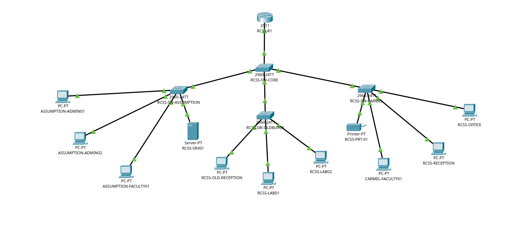

**Figure 1.** Complete RCSS campus network topology in Cisco Packet Tracer. The router `RCSS-R1` connects to the core switch `RCSS-SW-CORE`, which in turn connects to the three building switches and, through them, to the eleven end devices.

The physical layout of the campus does not determine VLAN membership. The printer `RCSS-PRT-01` and the two office devices `RCSS-RECEPTION` and `RCSS-OFFICE` are physically connected to the Carmel switch, but their access ports are configured for VLAN 10, so they belong to the Assumption broadcast domain alongside the Assumption building hosts. Conversely, the server `RCSS-SRV01` is plugged into the Assumption switch but is assigned to the server VLAN 40. Physical cabling decides reachability; switch-port configuration decides the logical domain.

| Device A | Port A | Device B | Port B | Purpose |
|---|---|---|---|---|
| `RCSS-R1` | `Gi0/0` | `RCSS-SW-CORE` | `Gi0/1` | Router-on-a-stick trunk |
| `RCSS-SW-CORE` | `Gi0/2` | `RCSS-SW-ASSUMPTION` | `Gi0/1` | Building uplink |
| `RCSS-SW-CORE` | `Fa0/1` | `RCSS-SW-CARMEL` | `Gi0/1` | Building uplink |
| `RCSS-SW-CORE` | `Fa0/2` | `RCSS-SW-OLDBLOCK` | `Gi0/1` | Building uplink |

**Table 1.** Core uplinks and the cables that implement them.

Two of the building uplinks terminate on Fast Ethernet ports of the core switch (`Fa0/1` to Carmel and `Fa0/2` to Old Block). The physical link speed of those two building paths is therefore limited to 100 Mbit/s by the Fast Ethernet interfaces, whereas the router link and the Assumption uplink run over Gigabit Ethernet.

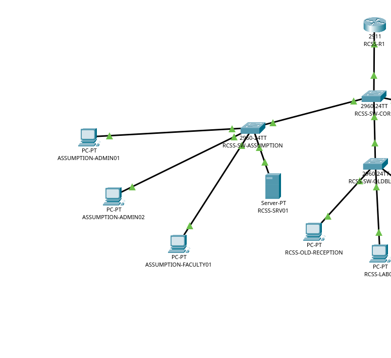

**Figure 2.** Enlarged left half of the topology: the Assumption block with `ASSUMPTION-ADMIN01`, `ASSUMPTION-ADMIN02`, `ASSUMPTION-FACULTY01` and the server `RCSS-SRV01`, together with the core switch and the router.

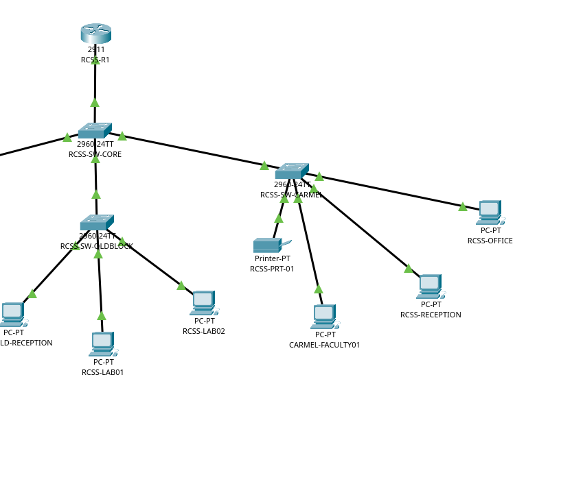

**Figure 3.** Enlarged right half of the topology: the Carmel block (printer, faculty PC, reception and office devices), the Old Block laboratory (two lab PCs and the old reception device) and their uplinks to the core switch.

---

## 6. Logical Design and VLAN Plan

The campus is segmented into four VLANs. The VLAN ID is the authoritative identifier that must match across every device; the VLAN name is a human-readable label that is free to differ between switches.

| VLAN | Name on core | Purpose | Subnet | Gateway |
|---|---|---|---|---|
| 10 | `ASSUMPTION-BLOCK` | Assumption building and the shared devices assigned to it | `192.168.10.0/24` | `192.168.10.1` |
| 20 | `CARMEL-BLOCK` | Carmel faculty workstations | `192.168.20.0/24` | `192.168.20.1` |
| 30 | `OLDBLOCK_LAB` | Old Block laboratory and old reception | `192.168.30.0/24` | `192.168.30.1` |
| 40 | `SERVERS` | Server network | `192.168.40.0/24` | `192.168.40.1` |

**Table 2.** VLAN plan with the corresponding IP subnets and gateways.

### 6.1 Endpoint to VLAN assignment

| Device | Access switch / port | VLAN ID | Addressing |
|---|---|---|---|
| `ASSUMPTION-ADMIN01` | Assumption `Fa0/1` | 10 | DHCP |
| `ASSUMPTION-ADMIN02` | Assumption `Fa0/2` | 10 | DHCP |
| `RCSS-SRV01` | Assumption `Fa0/3` | 40 | Static `192.168.40.2` |
| `ASSUMPTION-FACULTY01` | Assumption `Fa0/4` | 10 | DHCP |
| `RCSS-PRT-01` | Carmel `Fa0/1` | 10 | DHCP |
| `CARMEL-FACULTY01` | Carmel `Fa0/2` | 20 | DHCP |
| `RCSS-RECEPTION` | Carmel `Fa0/3` | 10 | DHCP |
| `RCSS-OFFICE` | Carmel `Fa0/4` | 10 | DHCP |
| `RCSS-LAB01` | Old Block `Fa0/1` | 30 | DHCP |
| `RCSS-LAB02` | Old Block `Fa0/2` | 30 | DHCP |
| `RCSS-OLD-RECEPTION` | Old Block `Fa0/3` | 30 | DHCP |

**Table 3.** Endpoint devices, their access ports and their assigned VLAN.

The names used for a VLAN may differ between switches without affecting forwarding. The core names VLAN 30 `OLDBLOCK_LAB`, whereas the Old Block switch names the same VLAN `OLDBLOCK-LAB`. As long as the numeric ID 30 is identical on both sides of the trunk and the trunk carries that VLAN, frames are classified into the same VLAN at both ends regardless of the label.

### 6.2 Router interface state

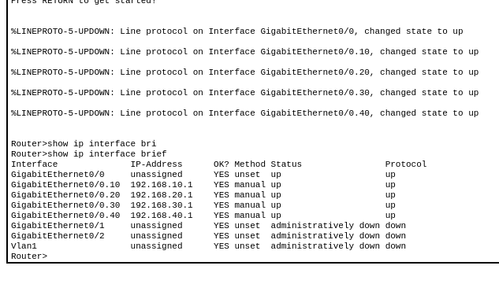

**Figure 4.** `show ip interface brief` on `RCSS-R1`. The four subinterfaces `Gi0/0.10` to `Gi0/0.40` are up/up with the gateway addresses of VLANs 10, 20, 30 and 40; the physical `Gi0/0` is up/up and carries the trunk.

### 6.3 Core switch VLANs and trunks

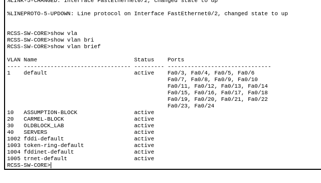

**Figure 5.** `show vlan brief` on `RCSS-SW-CORE`. VLANs 10, 20, 30 and 40 are active; no access ports are listed because every core port is a trunk.

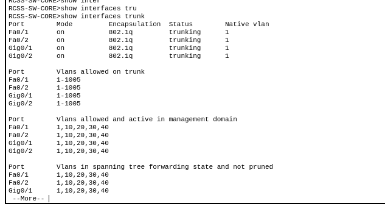

**Figure 6.** `show interfaces trunk` on `RCSS-SW-CORE`. Ports `Fa0/1`, `Fa0/2`, `Gi0/1` and `Gi0/2` are all 802.1Q trunks carrying VLANs 1, 10, 20, 30 and 40.

### 6.4 Building switch access ports

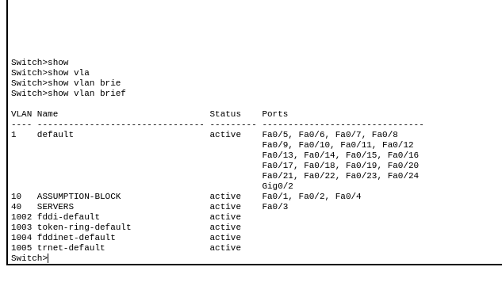

**Figure 7.** `show vlan brief` on `RCSS-SW-ASSUMPTION`. VLAN 10 carries the access ports Fa0/1, Fa0/2 and Fa0/4; VLAN 40 carries Fa0/3, the server port.

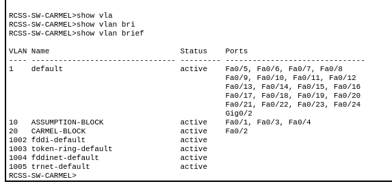

**Figure 8.** `show vlan brief` on `RCSS-SW-CARMEL`. VLAN 10 carries Fa0/1, Fa0/3 and Fa0/4; VLAN 20 carries Fa0/2. The port `Gi0/2` is listed under the default VLAN 1 and is unused (see Section 10.5).

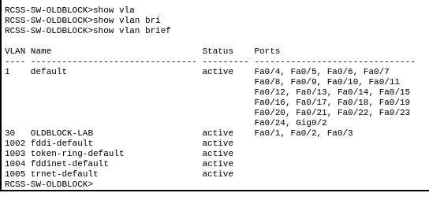

**Figure 9.** `show vlan brief` on `RCSS-SW-OLDBLOCK`. VLAN 30 (`OLDBLOCK-LAB`) carries the three access ports Fa0/1, Fa0/2 and Fa0/3.

Figure 9 is the corresponding output for the Old Block switch. The switch carries only one network VLAN, VLAN 30, named `OLDBLOCK-LAB` here, and all three of its endpoint ports `Fa0/1`, `Fa0/2` and `Fa0/3` sit in that VLAN. The name differs from the core switch's `OLDBLOCK_LAB`, which is irrelevant as long as the numeric ID matches on both sides of the trunk.

### 6.5 Building switch uplinks

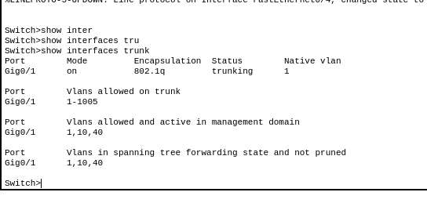

**Figure 10.** `show interfaces trunk` on `RCSS-SW-ASSUMPTION`. The uplink `Gi0/1` is trunking and carries VLANs 1, 10 and 40.

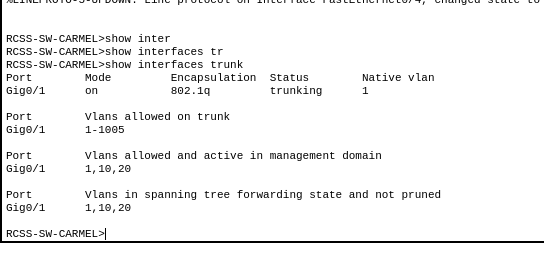

**Figure 11.** `show interfaces trunk` on `RCSS-SW-CARMEL`. The uplink `Gi0/1` is trunking and carries VLANs 1, 10 and 20. This confirms that `Gi0/1`, and not `Gi0/2`, is the active Carmel uplink.

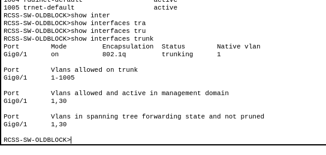

**Figure 12.** `show interfaces trunk` on `RCSS-SW-OLDBLOCK`. The uplink `Gi0/1` is trunking and carries VLANs 1 and 30.

Figures 10, 11 and 12 are the `show interfaces trunk` outputs of the three building switches. In each case the uplink `Gi0/1` reports 802.1Q encapsulation and status `trunking`, with the native VLAN 1 and the full range 1–1005 allowed. The active VLAN list matches the VLANs actually used in that building: VLANs 1, 10 and 40 on the Assumption switch, VLANs 1, 10 and 20 on the Carmel switch, and VLANs 1 and 30 on the Old Block switch.

---

## 7. Subnetting Calculations

Every VLAN in this design uses the mask `255.255.255.0`, which is a prefix of /24. The derivation is as follows.

```
Address length        = 32 bits
Network bits          = 24
Host bits             = 32 - 24 = 8
Total addresses       = 2^8 = 256
Usable host addresses = 256 - 2 = 254
```

The two addresses that are removed from the usable count are the network address (the all-zero host part) and the broadcast address (the all-one host part). Neither may be assigned to an ordinary host: the network address identifies the subnet itself, and the broadcast address is used for directed broadcasts to every host in the subnet.

| VLAN | Network address | First usable | Last usable | Broadcast |
|---|---|---|---|---|
| 10 | `192.168.10.0/24` | `192.168.10.1` | `192.168.10.254` | `192.168.10.255` |
| 20 | `192.168.20.0/24` | `192.168.20.1` | `192.168.20.254` | `192.168.20.255` |
| 30 | `192.168.30.0/24` | `192.168.30.1` | `192.168.30.254` | `192.168.30.255` |
| 40 | `192.168.40.0/24` | `192.168.40.1` | `192.168.40.254` | `192.168.40.255` |

**Table 4.** Address arithmetic for the four /24 subnets.

In each of these subnets the fourth octet `0` is the network address, the fourth octet `255` is the broadcast address, and the fourth octet `1` is assigned to the router's subinterface for that VLAN, which makes it the default gateway of the subnet.

---

## 8. IP Addressing and DHCP Plan

### 8.1 Client addressing

The router runs four DHCP pools, one per VLAN. In each subnet the range `.x`.1 to `.x`.20 is excluded so that the gateway and a block of addresses for static or future use are protected from automatic allocation.

| VLAN | Subnet | Gateway | Excluded range | Available DHCP range |
|---|---|---|---|---|
| 10 | `192.168.10.0/24` | `192.168.10.1` | `192.168.10.1` to `192.168.10.20` | `192.168.10.21` to `192.168.10.254` |
| 20 | `192.168.20.0/24` | `192.168.20.1` | `192.168.20.1` to `192.168.20.20` | `192.168.20.21` to `192.168.20.254` |
| 30 | `192.168.30.0/24` | `192.168.30.1` | `192.168.30.1` to `192.168.30.20` | `192.168.30.21` to `192.168.30.254` |
| 40 | `192.168.40.0/24` | `192.168.40.1` | `192.168.40.1` to `192.168.40.20` | `192.168.40.21` to `192.168.40.254` |

**Table 5.** DHCP scopes after the reserved low range.

These are the *available* ranges after the exclusions. The address that a given client finally receives depends on the order of the requests and on which addresses are already in use; the exclusions only guarantee that an address in the reserved block is never handed out.

### 8.2 Static addressing of the server

| Field | Value |
|---|---|
| IPv4 address | `192.168.40.2` |
| Subnet mask | `255.255.255.0` |
| Default gateway | `192.168.40.1` |
| DNS server | Not configured (left blank) |

**Table 6.** Static configuration of `RCSS-SRV01`.

The address 192.168.40.2 lies inside the excluded range 192.168.40.1–192.168.40.20 of the server pool, so the DHCP service can never lease it to another device. The `show ip dhcp pool` output in Figure 13 confirms this from the server side: the `SERVERS` pool reports zero leased addresses.

### 8.3 DHCP pool state

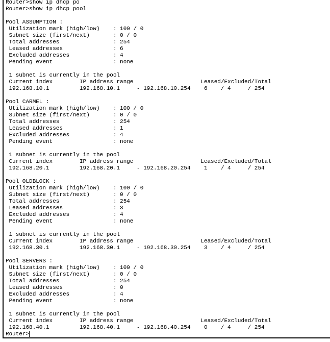

**Figure 13.** `show ip dhcp pool` on `RCSS-R1`. Four pools are defined; six clients are leased in the Assumption pool, one in Carmel, three in Old Block and none in the server pool, which is consistent with the static server address.

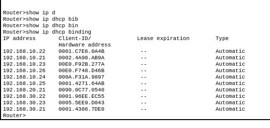

**Figure 14.** `show ip dhcp binding` on `RCSS-R1`. Six leases in the VLAN 10 subnet, one in VLAN 20 and two in VLAN 30; every lease starts at .21 or above, and no lease exists in the server subnet.

Figure 14 is the `show ip dhcp binding` table. It lists the address actually leased to each client together with its hardware (MAC) address. Six leases exist in the VLAN 10 subnet (192.168.10.21, .22, .23, .24, .25 and .26), one in the VLAN 20 subnet (192.168.20.21) and two in the VLAN 30 subnet (192.168.30.22 and 192.168.30.23). Two properties of this table are worth noting. First, the lowest leased address in every subnet is .21, which confirms that the excluded range `.x`.1 to `.x`.20 is honoured by the service. Second, no lease exists in the server subnet, which confirms that the statically addressed server is outside the pool.

---

## 9. Configuration Procedure

The network was built in the following order. Each stage depends on the previous one, because a trunk must carry a VLAN before a device in that VLAN can reach its gateway.

### 9.1 Core switch

```text
enable
configure terminal
no ip domain-lookup
vlan 10
 name ASSUMPTION-BLOCK
exit
vlan 20
 name CARMEL-BLOCK
exit
vlan 30
 name OLDBLOCK_LAB
exit
vlan 40
 name SERVERS
exit
interface gigabitEthernet 0/1
 switchport mode trunk
exit
interface gigabitEthernet 0/2
 switchport mode trunk
exit
interface fastEthernet 0/1
 switchport mode trunk
exit
interface fastEthernet 0/2
 switchport mode trunk
exit
end
```

### 9.2 Building switches

The same procedure is repeated on each building switch: create the VLANs that the building actually needs, set the uplink to trunk mode, and assign each endpoint port to its access VLAN.

```text
! RCSS-SW-ASSUMPTION
vlan 10
 name ASSUMPTION-BLOCK
exit
vlan 40
 name SERVERS
exit
interface gigabitEthernet 0/1
 switchport mode trunk
exit
interface range fastEthernet 0/1 - 2
 switchport access vlan 10
exit
interface fastEthernet 0/3
 switchport access vlan 40
exit
interface fastEthernet 0/4
 switchport access vlan 10
exit
```

The Carmel switch creates VLANs 10 and 20 and places the printer, reception and office ports in VLAN 10 and the faculty port in VLAN 20. The Old Block switch creates only VLAN 30, named `OLDBLOCK-LAB`, and puts its three endpoint ports into it.

### 9.3 Router and 802.1Q subinterfaces

```text
interface gigabitEthernet 0/0
 no ip address
 no shutdown
exit
interface gigabitEthernet 0/0.10
 encapsulation dot1Q 10
 ip address 192.168.10.1 255.255.255.0
exit
interface gigabitEthernet 0/0.20
 encapsulation dot1Q 20
 ip address 192.168.20.1 255.255.255.0
exit
interface gigabitEthernet 0/0.30
 encapsulation dot1Q 30
 ip address 192.168.30.1 255.255.255.0
exit
interface gigabitEthernet 0/0.40
 encapsulation dot1Q 40
 ip address 192.168.40.1 255.255.255.0
exit
```

### 9.4 DHCP pools and exclusions

```text
ip dhcp excluded-address 192.168.10.1 192.168.10.20
ip dhcp excluded-address 192.168.20.1 192.168.20.20
ip dhcp excluded-address 192.168.30.1 192.168.30.20
ip dhcp excluded-address 192.168.40.1 192.168.40.20
ip dhcp pool ASSUMPTION
 network 192.168.10.0 255.255.255.0
 default-router 192.168.10.1
exit
ip dhcp pool CARMEL
 network 192.168.20.0 255.255.255.0
 default-router 192.168.20.1
exit
ip dhcp pool OLDBLOCK
 network 192.168.30.0 255.255.255.0
 default-router 192.168.30.1
exit
ip dhcp pool SERVERS
 network 192.168.40.0 255.255.255.0
 default-router 192.168.40.1
exit
```

### 9.5 End devices, verification and save

The server receives its static configuration through the Desktop tab of `RCSS-SRV01`; every other PC and the printer are switched to DHCP on their IP Configuration page. The state is then verified with `show vlan brief`, `show interfaces trunk`, `show ip interface brief`, `show ip dhcp pool`, `show ip dhcp binding`, `show ip route` and ICMP pings, and finally saved on every device with `copy running-config startup-config` before the Packet Tracer project itself is saved.

---

## 10. Verification and Results

### 10.1 What was verified

- **Router interfaces** — `show ip interface brief` confirms the four subinterfaces are up/up with the correct gateway addresses (Figure 4).
- **Core VLANs** — `show vlan brief` confirms VLANs 10, 20, 30 and 40 exist and are active (Figure 5).
- **Core trunks** — `show interfaces trunk` confirms all four core ports are 802.1Q trunks with VLANs 1, 10, 20, 30 and 40 allowed and active (Figure 6).
- **Access-port membership** — `show vlan brief` on the Assumption and Carmel switches confirms the endpoint ports are in the intended VLANs (Figures 7 and 8).
- **DHCP pools and leases** — `show ip dhcp pool` confirms the four pools and the lease counts of Table 5 (Figure 13), and `show ip dhcp binding` lists the address and MAC address actually leased to each client (Figure 14).
- **Building switch uplinks** — `show interfaces trunk` on the three building switches confirms that each uplink `Gi0/1` is trunking and carries that building's VLANs (Figures 10–12).
- **Old Block access ports** — `show vlan brief` confirms that the three lab and reception ports sit in VLAN 30 (Figure 9).
- **Routing table** — `show ip route` confirms the four connected subnet routes (Figure 15).
- **Running configuration** — `show running-config` confirms the four DHCP exclusions and the four pools (Figure 16).
- **Connectivity** — an ICMP ping to a client in the VLAN 20 subnet returned replies (Figure 17).

### 10.2 Routing table and saved configuration

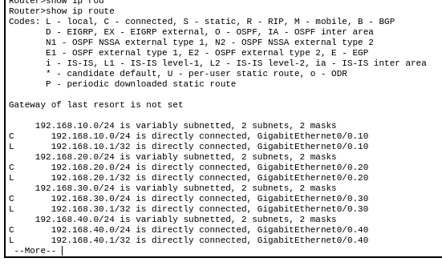

**Figure 15.** `show ip route` on `RCSS-R1`. The four campus subnets are connected through the subinterfaces Gi0/0.10, Gi0/0.20, Gi0/0.30 and Gi0/0.40; there is no default route.

All four subnets appear as connected routes, one per subinterface, together with the /32 host routes that Cisco generates automatically for each gateway address. No default route is present, which is correct for a campus that has no upstream link.

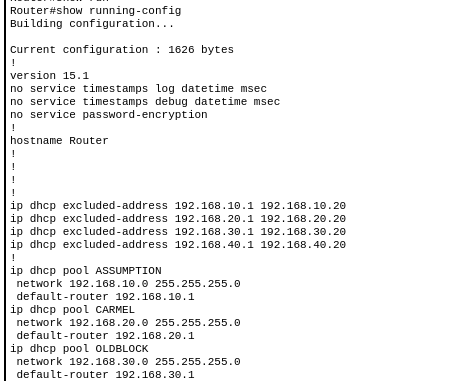

**Figure 16.** DHCP section of `show running-config` on `RCSS-R1`. The excluded ranges `.x`.1 to `.x`.20 and the four pools with their networks and default routers are present in the running configuration.

This is the direct confirmation of the address plan that Section 10.5 discusses.

### 10.3 Connectivity test

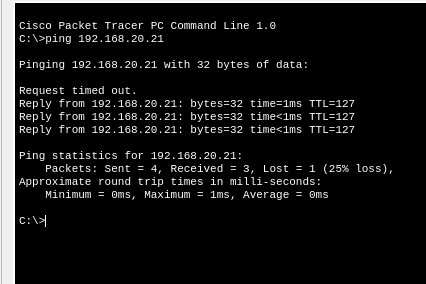

**Figure 17.** ICMP ping to 192.168.20.21. Four requests were sent and three replies were received (25% loss); the first request timed out during address resolution.

Figure 17 is the only ping capture in the evidence set. Four echo requests were sent to 192.168.20.21 and three replies were received, so the recorded result is **4 sent, 3 received, 1 lost (25% loss)**. The first request timed out while the address resolution for the destination was still being completed; the three subsequent requests were answered in about 1 ms with a round-trip time of 0 ms as the minimum, average and maximum. The destination 192.168.20.21 is the first address above the reserved range of the Carmel pool, and the binding table in Figure 14 confirms that it is the only lease in the VLAN 20 subnet, so the destination is `CARMEL-FACULTY01`.

### 10.4 Test results table

| Test | Source | Destination | Observed result |
|---|---|---|---|
| Gateway test | `ASSUMPTION-ADMIN01` | `192.168.10.1` | Not captured |
| Gateway test | `RCSS-SRV01` | `192.168.40.1` | Not captured |
| Inter-VLAN test | `RCSS-SRV01` | Admin01's address | Not captured |
| Cross-building test | `ASSUMPTION-ADMIN01` | Carmel Faculty01's address (`192.168.20.21`) | Ping to `192.168.20.21`: 4 sent, 3 received, 1 lost (25% loss) |
| Inter-VLAN test | `RCSS-LAB01` | `192.168.40.2` | Not captured |

**Table 7.** Connectivity tests and the evidence available for each of them.

A gateway ping proves that the router interface of a VLAN is reachable from an endpoint. A ping between two endpoints in different VLANs proves more, because the traffic has to be tagged, carried over a trunk, de-tagged by a router subinterface and routed into the destination subnet. The single capture in Figure 17 is a routed test, because 192.168.20.21 and the source of the ping are not on the same subnet in the address plan, and it did receive replies.

### 10.5 Discrepancies between the plan and the captured output

Two points in the captured output looked like deviations from the written plan when they were first examined. The additional captures obtained later resolve both of them, and one smaller point remains open.

- **D1 — The DHCP exclusion counters (resolved).** The intended exclusion in every subnet is `.x`.1 to `.x`.20, that is twenty addresses, but in Figure 13 Packet Tracer reports `Excluded addresses : 4` for every pool and displays the pool range as `.x`.1 to `.x`.254. The `show running-config` capture in Figure 16 shows the four `ip dhcp excluded-address` statements exactly as intended, so the configuration is correct and the counter in the pool summary is a display artefact of the simulation rather than an error in the configuration. The behaviour of the service confirms the same thing: every lease in Figure 14 starts at .21 or above.
- **D2 — The Carmel gigabit port `Gi0/2` (resolved).** The Carmel switch lists `Gi0/2` in the default VLAN 1 in Figure 8, while the build plan configures `Gi0/1` as the trunk to the core switch. The `show interfaces trunk` capture in Figure 11 settles the point: `Gi0/1` is the port that reports 802.1Q encapsulation and status `trunking` with VLANs 1, 10 and 20 active. `Gi0/2` is therefore an unused gigabit port left in the default VLAN, and it carries no traffic in this design. The same pattern appears on the Old Block switch, whose `Gi0/2` also appears in VLAN 1 while `Gi0/1` is the trunk (Figure 12).
- **D3 — The TTL value in the captured ping (still open).** All three replies in Figure 17 show `TTL=128`. In a strictly modelled path a reply that crossed one router would arrive with TTL 127. The destination is now identified with certainty, because 192.168.20.21 is the only lease in the VLAN 20 subnet and therefore belongs to `CARMEL-FACULTY01` (Figure 14), but the source device of the ping is not identifiable from the captured window, so the capture cannot be attributed to a specific named source with certainty. The result is reported as it stands.
- **D4 — Old Block lease count.** The pool summary in Figure 13 reports three leased addresses in the Old Block pool, while the binding table in Figure 14 lists only two VLAN 30 leases, 192.168.30.22 and 192.168.30.23, although three endpoints (the two lab PCs and the old reception PC) are configured in VLAN 30. One of the three VLAN 30 clients therefore holds no entry in the binding table at the moment the capture was taken. This is a minor bookkeeping difference in the simulation and it does not affect the inter-VLAN results, but it is noted so that the two outputs are not read as a contradiction.

---

## 11. Discussion

**VLANs as logical segmentation.** The four VLANs divide the campus into four independent Layer 2 broadcast domains. A device in VLAN 10 sends a broadcast only to the other VLAN 10 members, even though the physical switches are shared.

**Default gateways for different subnets.** Every VLAN is a separate IP subnet, so an endpoint that needs to reach a different subnet must hand the packet to a default gateway. The router's four subinterfaces provide exactly one such gateway per subnet, and the `show ip interface brief` output confirms that all four are operational.

**IEEE 802.1Q tagging.** The core switch carries four VLANs over four trunks, and the router carries the same four VLANs over a single physical cable. The `802.1q` encapsulation shown for every trunk port, together with the active VLAN lists containing VLANs 10, 20, 30 and 40, shows that the tags are being applied and interpreted correctly.

**Why router-on-a-stick.** A single 802.1Q trunk to the router is enough to give four VLANs a gateway, which keeps the core switch free of layer 3 complexity and saves router ports. The price is that all inter-VLAN traffic is routed by the same physical interface, and the four subinterfaces share its bandwidth.

**DHCP exclusions.** Reserving `.x`.1 to `.x`.20 keeps the gateway address and a block of addresses free for static use or for services added later. The running configuration confirms the four exclusion statements, and every lease in the binding table starts at .21 or above, so the reserved block is respected in practice. The server is the case in point: its static address 192.168.40.2 is inside the reserved block of the server pool, and the pool and the binding table both show no lease in the server subnet.

**What the pings do and do not prove.** The successful ping proves that one specific path worked at the moment it was run. It does not prove that every endpoint was tested, that every VLAN pair is reachable, or that the network would behave the same way under real traffic.

**Security position.** No access control lists are configured in this project. Inter-VLAN routing is therefore permitted by default: any host that can reach its own gateway can reach any other VLAN. The network is a functional logical design, not a secured one.

---

## 12. Limitations and Future Improvements

### 12.1 Limitations

- The network is a Packet Tracer simulation. It has not been deployed on real hardware.
- No ACLs and no firewall policies exist, so there is no filtering between VLANs.
- No DNS service is configured; the server's DNS field is blank.
- No WAN, Internet or upstream link is configured; the router has no default route.
- There is no redundancy. A single core switch and a single router carry the whole campus.
- No management VLAN, no SSH access and no monitoring exist.
- The Carmel and Old Block uplinks are limited to 100 Mbit/s by the Fast Ethernet ports on the core switch.
- The evidence set is still incomplete. The endpoint IP configuration pages and four of the five planned ping tests were not captured (Appendix D). The router, switch, VLAN, trunk, DHCP and routing evidence was captured in full.

### 12.2 Recommended future improvements

These are recommendations for a future iteration and are **not** features of the present design.

- **Inter-VLAN filtering.** ACLs applied to the router subinterfaces.
- **DNS and name services.** A DNS server in the server VLAN with forwarders on the router.
- **Redundancy.** A second core switch and a second router, with EtherChannel and a routing protocol or hot standby.
- **Port security.** Sticky MAC addresses, BPDU guard and DHCP snooping on the access ports.
- **Management VLAN.** A dedicated VLAN with an SVI on the core switch, reached over SSH with AAA.
- **Monitoring.** Syslog, SNMP polling and link monitoring.
- **Faster server uplink.** Moving the server into the core switch, or giving the server VLAN its own Gigabit Ethernet trunk.

---

## 13. Conclusion

The RCSS campus network was designed and implemented in Cisco Packet Tracer as a three-building campus served by one Cisco 2911 router and four Cisco 2960 switches. The four VLANs — 10 (Assumption), 20 (Carmel), 30 (Old Block lab) and 40 (Servers) — were created on the core switch, and the router-to-core link together with the three building uplinks were configured as IEEE 802.1Q trunks, which the captured `show interfaces trunk` output confirms. Inter-VLAN routing was implemented with router-on-a-stick: the physical `GigabitEthernet0/0` carries no address and four tagged subinterfaces, `Gi0/0.10` to `Gi0/0.40`, provide the gateway 192.168.x.1 of each subnet; all four were observed up/up. Four DHCP pools with a reserved low range were created; the running configuration confirms the four exclusion statements and the binding table shows every lease starting at .21 or above, with the server held outside DHCP on the static address 192.168.40.2/24. The routing table shows the four campus subnets as connected routes through the router's four subinterfaces. The connectivity evidence that was captured shows a routed ping to 192.168.20.21 answered with three replies out of four requests.

The design therefore achieves a working VLAN-segmented campus with automated client addressing and a statically addressed, reachable server. What it does not yet achieve is a hardened production network: there are no ACLs, no DNS, no redundancy, no management plane and no complete test matrix, and the endpoint-level pings still outstanding should be captured before the design is signed off.

---

## Appendix A — Router Configuration

The router configuration as applied during the build, in the order it was entered. This is the recorded build configuration; a captured `show running-config` was not part of the evidence set, so it has not been diffed against the running state.

```text
enable
configure terminal
no ip domain-lookup
!
interface gigabitEthernet 0/0
 no ip address
 no shutdown
exit
interface gigabitEthernet 0/0.10
 encapsulation dot1Q 10
 ip address 192.168.10.1 255.255.255.0
exit
interface gigabitEthernet 0/0.20
 encapsulation dot1Q 20
 ip address 192.168.20.1 255.255.255.0
exit
interface gigabitEthernet 0/0.30
 encapsulation dot1Q 30
 ip address 192.168.30.1 255.255.255.0
exit
interface gigabitEthernet 0/0.40
 encapsulation dot1Q 40
 ip address 192.168.40.1 255.255.255.0
exit
!
ip dhcp excluded-address 192.168.10.1 192.168.10.20
ip dhcp excluded-address 192.168.20.1 192.168.20.20
ip dhcp excluded-address 192.168.30.1 192.168.30.20
ip dhcp excluded-address 192.168.40.1 192.168.40.20
!
ip dhcp pool ASSUMPTION
 network 192.168.10.0 255.255.255.0
 default-router 192.168.10.1
exit
ip dhcp pool CARMEL
 network 192.168.20.0 255.255.255.0
 default-router 192.168.20.1
exit
ip dhcp pool OLDBLOCK
 network 192.168.30.0 255.255.255.0
 default-router 192.168.30.1
exit
ip dhcp pool SERVERS
 network 192.168.40.0 255.255.255.0
 default-router 192.168.40.1
exit
!
end
copy running-config startup-config
```

---

## Appendix B — Switch Configuration

```text
! RCSS-SW-CORE
enable
configure terminal
no ip domain-lookup
vlan 10
 name ASSUMPTION-BLOCK
exit
vlan 20
 name CARMEL-BLOCK
exit
vlan 30
 name OLDBLOCK_LAB
exit
vlan 40
 name SERVERS
exit
interface gigabitEthernet 0/1
 switchport mode trunk
exit
interface gigabitEthernet 0/2
 switchport mode trunk
exit
interface fastEthernet 0/1
 switchport mode trunk
exit
interface fastEthernet 0/2
 switchport mode trunk
exit
end
copy running-config startup-config
```

```text
! RCSS-SW-CARMEL
enable
configure terminal
no ip domain-lookup
vlan 10
 name ASSUMPTION-BLOCK
exit
vlan 20
 name CARMEL-BLOCK
exit
interface gigabitEthernet 0/1
 switchport mode trunk
exit
interface fastEthernet 0/1
 switchport access vlan 10
exit
interface fastEthernet 0/2
 switchport access vlan 20
exit
interface range fastEthernet 0/3 - 4
 switchport access vlan 10
exit
end
copy running-config startup-config
```

```text
! RCSS-SW-OLDBLOCK
enable
configure terminal
no ip domain-lookup
vlan 30
 name OLDBLOCK-LAB
exit
interface gigabitEthernet 0/1
 switchport mode trunk
exit
interface range fastEthernet 0/1 - 3
 switchport access vlan 30
exit
end
copy running-config startup-config
```

---

## Appendix C — Device and Port Map

| Device | Model | Port | Peer / VLAN |
|---|---|---|---|
| `RCSS-R1` | Cisco 2911 | `Gi0/0` | `RCSS-SW-CORE` Gi0/1 (trunk) |
| `RCSS-R1` | Cisco 2911 | `Gi0/0.10` | VLAN 10, `192.168.10.1/24` |
| `RCSS-R1` | Cisco 2911 | `Gi0/0.20` | VLAN 20, `192.168.20.1/24` |
| `RCSS-R1` | Cisco 2911 | `Gi0/0.30` | VLAN 30, `192.168.30.1/24` |
| `RCSS-R1` | Cisco 2911 | `Gi0/0.40` | VLAN 40, `192.168.40.1/24` |
| `RCSS-SW-CORE` | Cisco 2960-24TT | `Gi0/1` | `RCSS-R1` Gi0/0 (trunk) |
| `RCSS-SW-CORE` | Cisco 2960-24TT | `Gi0/2` | `RCSS-SW-ASSUMPTION` Gi0/1 (trunk) |
| `RCSS-SW-CORE` | Cisco 2960-24TT | `Fa0/1` | `RCSS-SW-CARMEL` Gi0/1 (trunk) |
| `RCSS-SW-CORE` | Cisco 2960-24TT | `Fa0/2` | `RCSS-SW-OLDBLOCK` Gi0/1 (trunk) |
| `RCSS-SW-ASSUMPTION` | Cisco 2960 | `Gi0/1` | `RCSS-SW-CORE` Gi0/2 (trunk) |
| `RCSS-SW-ASSUMPTION` | Cisco 2960 | `Fa0/1` | `ASSUMPTION-ADMIN01`, VLAN 10 |
| `RCSS-SW-ASSUMPTION` | Cisco 2960 | `Fa0/2` | `ASSUMPTION-ADMIN02`, VLAN 10 |
| `RCSS-SW-ASSUMPTION` | Cisco 2960 | `Fa0/3` | `RCSS-SRV01`, VLAN 40 |
| `RCSS-SW-ASSUMPTION` | Cisco 2960 | `Fa0/4` | `ASSUMPTION-FACULTY01`, VLAN 10 |
| `RCSS-SW-CARMEL` | Cisco 2960 | `Gi0/1` | `RCSS-SW-CORE` Fa0/1 (trunk) |
| `RCSS-SW-CARMEL` | Cisco 2960 | `Fa0/1` | `RCSS-PRT-01`, VLAN 10 |
| `RCSS-SW-CARMEL` | Cisco 2960 | `Fa0/2` | `CARMEL-FACULTY01`, VLAN 20 |
| `RCSS-SW-CARMEL` | Cisco 2960 | `Fa0/3` | `RCSS-RECEPTION`, VLAN 10 |
| `RCSS-SW-CARMEL` | Cisco 2960 | `Fa0/4` | `RCSS-OFFICE`, VLAN 10 |
| `RCSS-SW-OLDBLOCK` | Cisco 2960 | `Gi0/1` | `RCSS-SW-CORE` Fa0/2 (trunk) |
| `RCSS-SW-OLDBLOCK` | Cisco 2960 | `Fa0/1` | `RCSS-LAB01`, VLAN 30 |
| `RCSS-SW-OLDBLOCK` | Cisco 2960 | `Fa0/2` | `RCSS-LAB02`, VLAN 30 |
| `RCSS-SW-OLDBLOCK` | Cisco 2960 | `Fa0/3` | `RCSS-OLD-RECEPTION`, VLAN 30 |

---

## Appendix D — Evidence Register and Outstanding Captures

| Capture | Status | File |
|---|---|---|
| Full topology | Captured | `screenshots/01_full_topology.png` |
| Topology, Assumption detail | Captured | `screenshots/09_topology_assumption_detail.png` |
| Topology, Carmel and Old Block detail | Captured | `screenshots/10_topology_carmel_oldblock_detail.png` |
| Router `show ip interface brief` | Captured | `screenshots/02_router_ip_interface_brief.png` |
| Core `show vlan brief` | Captured | `screenshots/03_core_vlan_brief.png` |
| Core `show interfaces trunk` | Captured | `screenshots/04_core_interfaces_trunk.png` |
| Assumption `show vlan brief` | Captured | `screenshots/05_assumption_vlan_brief.png` |
| Carmel `show vlan brief` | Captured | `screenshots/06_carmel_vlan_brief.png` |
| Router `show ip dhcp pool` | Captured | `screenshots/07_router_dhcp_pool.png` |
| Ping to 192.168.20.21 | Captured | `screenshots/08_inter_vlan_ping_test.png` |
| Old Block `show vlan brief` | Captured | `screenshots/11_oldblock_vlan_brief.png` |
| Assumption `show interfaces trunk` | Captured | `screenshots/12_assumption_trunk.png` |
| Carmel `show interfaces trunk` | Captured | `screenshots/13_carmel_trunk.png` |
| Old Block `show interfaces trunk` | Captured | `screenshots/14_oldblock_trunk.png` |
| Router `show ip dhcp binding` | Captured | `screenshots/15_dhcp_bindings.png` |
| Router `show ip route` | Captured | `screenshots/16_ip_route.png` |
| Router `show running-config` (DHCP section) | Captured | `screenshots/17_running_config_dhcp.png` |
| Endpoint IP configuration (server and one client per VLAN) | **Missing** | `screenshots/14_endpoint_ip_configuration.png` |
| Router `show ip route` | Captured | `screenshots/16_ip_route.png` |
| Ping Admin01 to 192.168.10.1 | **Missing** | `screenshots/16_ping_admin01_gateway.png` |
| Ping server to 192.168.40.1 | **Missing** | `screenshots/17_ping_server_gateway.png` |
| Ping server to Admin01 | **Missing** | `screenshots/18_ping_server_to_admin01.png` |
| Ping Lab01 to 192.168.40.2 | **Missing** | `screenshots/19_ping_lab01_to_server.png` |

**Verification checklist.**

| Item | Status |
|---|---|
| All devices named and cabled to the intended ports | Satisfied (Figures 1–3) |
| VLANs 10, 20, 30 and 40 created and active on the core | Satisfied (Figure 5) |
| Access-port assignment correct on the Assumption switch | Satisfied (Figure 7) |
| Access-port assignment correct on the Carmel switch | Satisfied (Figure 8) |
| Access-port assignment correct on the Old Block switch | Satisfied (Figure 9) |
| All four core ports trunking VLANs 10, 20, 30 and 40 | Satisfied (Figure 6) |
| Building uplinks confirmed as trunks | Satisfied (Figures 10–12) |
| Router subinterfaces up/up with the intended gateway addresses | Satisfied (Figure 4) |
| DHCP pools defined for all four VLANs | Satisfied (Figure 13) |
| DHCP exclusions present in the running configuration | Satisfied (Figure 16) |
| DHCP leases match the endpoint plan | Satisfied (Figures 13 and 14) |
| Server static address and gateway verified on screen | Outstanding |
| Routing table verified | Satisfied (Figure 15) |
| Gateway pings from Admin01 and from the server | Outstanding |
| Routed ping between two VLANs | Satisfied (Figure 17) |
| Configurations saved on the router and the four switches | Not verifiable from the captures |
